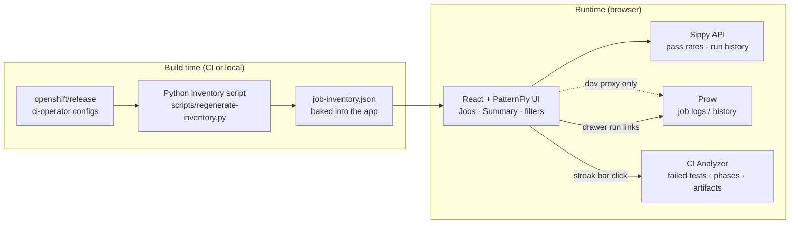
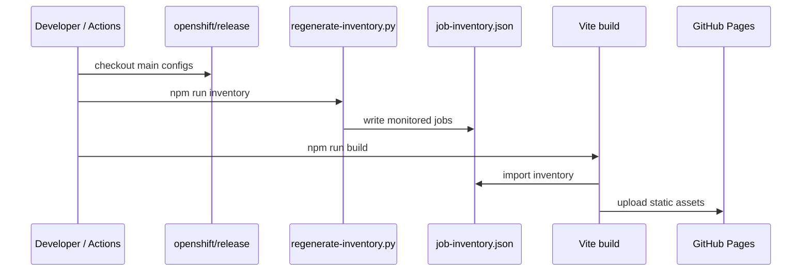
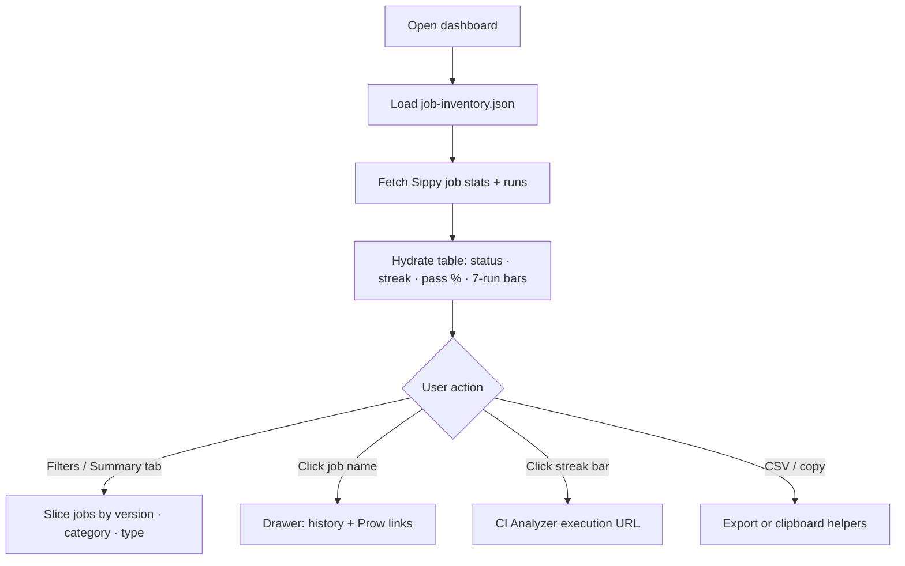

# IBM Z OpenShift Job Monitor

Live dashboard for **IBM Z (s390x)** OpenShift CI periodic jobs — pass rates, upgrade health, and release readiness across OCP versions.

**Site URL:** **https://ibm-adarsh.github.io/ibmz-openshift-job-monitor/**

Data is loaded from **Sippy** and **Prow**. The monitored job list is generated automatically from **`openshift/release`** by **cluster profile** (no hand-maintained job name lists).

---

## Architecture and flow

This section explains how the dashboard is built, where live data comes from, and how a user moves through the UI. No backend server is required in production — GitHub Pages serves a static React app, and the browser talks to Sippy directly.

### Big picture



**In one sentence:** the job *list* is derived at build/sync time by scanning all of `openshift/release` `ci-operator/config` for jobs that use monitored `libvirt-s390x-vpn*` cluster profiles (OCP 4.13–5.x); live *status and history* are fetched in the browser from Sippy; Prow and the CI Analyzer are used as deep links for logs and failure analysis.

A scheduled GitHub Action (**.github/workflows/sync-inventory.yml**) reclones `openshift/release` every morning at **07:00 IST**, regenerates `job-inventory.json`, and commits if anything changed — so new/removed jobs appear without manual edits.

### Technology stack

| Layer | Choice | Role |
|-------|--------|------|
| UI | **TypeScript**, **React 19**, **PatternFly 6** | Dashboard pages, filters, tables, drawer |
| App shell | **Vite 8** | Dev server, production static build |
| Inventory | **Python 3** (`regenerate-inventory.py`) | Profile-driven scan of release configs → `job-inventory.json` |
| Profile list | `scripts/monitored-cluster-profiles.json` | Which `cluster_profile` values to follow |
| Auto sync | **GitHub Actions** (`sync-inventory.yml`) | Daily 07:00 IST clone release + commit inventory |
| Lint / types | **oxlint**, **TypeScript** | Static checks before build |
| Hosting | **GitHub Pages** + Actions | Static site; rebuild inventory on each deploy |
| Live CI stats | **Sippy** (`sippy.dptools.openshift.org`) | Pass rates, run lists, last pass, flakes |
| Job logs | **Prow** (`prow.ci.openshift.org`) | Build view / history (drawer links) |
| Failure analysis | **CI Analyzer** (`ibm-adarsh.github.io/ci-analyzer`) | Failed tests, PRE/TEST/POST phases, leases, artifacts |
| Job definitions | **openshift/release** | Source of truth for which periodics exist |

### Where each external system is used

| System | Used for | Not used for |
|--------|----------|--------------|
| **openshift/release** | Which IBM Z jobs to monitor (names, OCP version, category) | Live pass/fail results |
| **Sippy** | Latest outcome, 7-run / 7-day / 30-day pass %, run sparkline data | Serving the website itself |
| **Prow** | Opening a specific run’s deck/logs from the job drawer | Primary data source on GitHub Pages |
| **CI Analyzer** | Opening a streak bar into failed tests, phases, timing, artifact dirs | Replacing Sippy pass-rate math |

### Build-time flow (job inventory)

1. Clone or refresh `openshift/release` (`ci-operator/config` tree).
2. Run `npm run inventory` (Python) to keep jobs whose `cluster_profile` is monitored and OCP is 4.13–5.x.
3. Write `src/data/job-inventory.json`.
4. Vite builds the React app with that JSON embedded.
5. On `main`, GitHub Actions does steps 1–4 and publishes `dist/` to Pages.



### Runtime flow (live dashboard)

1. User opens the static site.
2. App loads the baked-in inventory (all monitored jobs / versions).
3. Browser calls **Sippy** for each job’s stats and recent runs (CORS-enabled).
4. UI hydrates rows: status, streak, last green, pass meters, run bars.
5. In **local dev**, Vite can also proxy Prow HTML history; on Pages, Sippy is enough for the table.



### User journey in the UI

1. **Jobs tab** — swimlanes per OCP version; filter by homogeneous / heterogeneous / upgrade / hypershift and by test type (e2e, serial, FIPS, …).
2. **Pass rates** — last **7 runs**, **7 days**, and **30 days** (green ≥60%, amber 40–59%, red &lt;40%).
3. **Click job name** — drawer with previous runs and direct **Prow** links (kept as the classic CI view).
4. **Click a streak bar** — opens that run in the **CI Analyzer** for failed tests, phase timing, leases, comparison context, and artifact links.
5. **Summary tab** — fleet overview, heatmap, upgrade path, CSV download.

### Key source files

| Path | Purpose |
|------|---------|
| `scripts/monitored-cluster-profiles.json` | Cluster profiles to monitor (source of truth for inclusion) |
| `scripts/regenerate-inventory.py` | Profile-driven job discovery from release configs |
| `src/data/job-inventory.json` | Generated monitored job list (auto-updated daily) |
| `.github/workflows/sync-inventory.yml` | Morning inventory sync + commit |
| `src/data/hydrateLive.ts` | Merge Sippy/Prow data into UI job models |
| `src/api/sippyClient.ts` | Sippy HTTP client |
| `src/api/prowClient.ts` | Prow history helper (mainly local/dev) |
| `src/utils/links.ts` | Prow, Sippy, config, and CI Analyzer URLs |
| `src/components/*` | PatternFly UI (table, drawer, summary, filters) |
| `.github/workflows/deploy-pages.yml` | Inventory sync + Pages deploy |

---

## Quick start (standalone repo + release clone)

### 1. Clone this repo, then pull `openshift/release` locally (gitignored)

Preferred: sparse clone under `.vendor/` (not tracked / not committed):

```bash
git clone https://github.com/ibm-adarsh/ibmz-openshift-job-monitor.git
cd ibmz-openshift-job-monitor

mkdir -p .vendor
git clone --depth 1 --filter=blob:none --sparse \
  https://github.com/openshift/release.git .vendor/openshift-release
cd .vendor/openshift-release
git sparse-checkout set ci-operator/config
cd ../..
```

Alternatively, keep a full sibling clone at `../release`. The inventory script auto-detects `.vendor/openshift-release`, then `../release`.

### 2. Setup (one command)

```bash
cd ibmz-openshift-job-monitor
npm run setup
```

Runs `npm install` and writes `src/data/job-inventory.json` from **all** `ci-operator/config` jobs that use your monitored cluster profiles (OCP **4.13–5.x**).

### 3. Run

```bash
npm run dev
```

Open **http://localhost:5173/**

---

## Job inventory

| Command | Description |
|---------|-------------|
| `npm run setup` | `npm install` + sync inventory |
| `npm run inventory` | Regenerate `src/data/job-inventory.json` only |
| `npm run list-jobs` | Print all jobs in the terminal (no file write) |

### Custom release path

```bash
export RELEASE_ROOT=/path/to/release
npm run inventory
```

Or:

```bash
python3 scripts/regenerate-inventory.py --release-root /path/to/release --list
```

After upstream CI config changes on **main**:

```bash
# vendor clone
cd .vendor/openshift-release && git pull origin main && cd ../..
# or sibling: cd ../release && git pull origin main
npm run inventory
```

---

## What gets synced?

**Rule:** every morning (and on each Pages deploy) scan **all** of `ci-operator/config/**` in `openshift/release` and include every test whose `cluster_profile` is listed in [`scripts/monitored-cluster-profiles.json`](scripts/monitored-cluster-profiles.json), when the job’s OCP version is in range (**4.13–5.x** by default).  
OCP version is taken from the job name, config filename, `releases:`, or related fields — so jobs outside `multiarch` / `hypershift` (for example kueue-operator on `-oz`) are included automatically. Profiles with zero jobs today (for example `libvirt-s390x-vpn-ipv6`) stay configured so they are picked up when release adds them.

| Cluster profile | Typical jobs |
|-----------------|--------------|
| `libvirt-s390x-vpn` | Homogeneous e2e / serial / FIPS / image-ecosystem / agent / upgrades |
| `libvirt-s390x-vpn-amd64` | Heterogeneous Z + x86 (`*-z-zx`, …) |
| `libvirt-s390x-vpn-arm64` | Heterogeneous Z + arm64 (`*-z-za`, …) |
| `libvirt-s390x-vpn-hcp` | Hypershift / MCE IBM Z periodics |
| `libvirt-s390x-vpn-ipv6` | IPv6 libvirt Z jobs (when present) |
| `libvirt-s390x-vpn-oz` | OZ / virt-oz style capacity pool (when present) |

IBM Cloud profiles (`ibmcloud-*`) are **not** monitored. To follow an additional profile later, add its name to `scripts/monitored-cluster-profiles.json` only — no job-by-job edits.

### Automatic morning sync

| Trigger | Workflow |
|---------|----------|
| Daily **07:00 IST** (01:30 UTC) | `.github/workflows/sync-inventory.yml` |
| Manual | Actions → **Sync job inventory** → Run workflow |
| Every Pages deploy | `.github/workflows/deploy-pages.yml` also regenerates inventory before build |

The sync job clones `openshift/release` main, runs `npm run inventory` / `regenerate-inventory.py`, and pushes `src/data/job-inventory.json` when the set of jobs changes.

---

## Dashboard

### Summary

- Fleet overview, 30-day pass matrix (click cell → filter Jobs), upgrade path health, CSV export

### Jobs

- Per-OCP swimlanes, filters, watchlist, 7d/30d pass rates, run sparklines

### Data

- **Last finished** outcome for pass/fail counts (not in-flight runs)
- Pass % = run-weighted (aborted excluded)
- Dev proxies Prow via Vite (`vite.config.ts`); Sippy is called directly

---

## Production build

```bash
npm run build
# Static files in dist/
```

---

## Host on GitHub Pages (public URL, live Sippy data)

The dashboard can run as a **static site** on GitHub Pages. Anyone with the URL can use it — no server required.

### How live data works

| Source | On GitHub Pages |
|--------|-----------------|
| **Sippy** (pass rates, run history, job stats) | Works — browser calls `sippy.dptools.openshift.org` directly (CORS enabled) |
| **Prow** HTML history | Not used in production builds (only local dev via Vite proxy) |
| **Job inventory** | Baked into the site at build time; CI refreshes it from `openshift/release` main on each deploy |

### One-time setup

1. Open **https://github.com/ibm-adarsh/ibmz-openshift-job-monitor/settings/pages**
2. Under **Build and deployment**, set **Source** to **GitHub Actions** (not “Deploy from branch”).

### Deploy

Every push to `main` runs `.github/workflows/deploy-pages.yml`:

- Clones `openshift/release` (main)
- Regenerates `job-inventory.json`
- Builds with base path `/ibmz-openshift-job-monitor/`
- Publishes to GitHub Pages

**Site URL:** **https://ibm-adarsh.github.io/ibmz-openshift-job-monitor/**

Manual redeploy: **Actions** → **Deploy GitHub Pages** → **Run workflow**.

### Local build matching Pages

```bash
VITE_BASE_PATH=/ibmz-openshift-job-monitor/ npm run build
npx vite preview --base /ibmz-openshift-job-monitor/
```

---

## Repo layout

```text
ibmz-openshift-job-monitor/
  scripts/
    setup.sh
    regenerate-inventory.py
    monitored-cluster-profiles.json   # profiles to follow (edit to expand)
  .github/workflows/
    sync-inventory.yml                # daily 07:00 IST auto sync + commit
    deploy-pages.yml                  # Pages build (also refreshes inventory)
  src/
    data/job-inventory.json           # generated — updated by sync Action
    components/                       # React + PatternFly UI
```

---

## Related

- [openshift/release](https://github.com/openshift/release) — CI job definitions
- [Sippy](https://sippy.dptools.openshift.org/) — OpenShift CI analytics
- [Prow](https://prow.ci.openshift.org/) — job run logs
- [CI Analyzer](https://ibm-adarsh.github.io/ci-analyzer/) — failed tests, phases, leases, artifacts
- [Live site](https://ibm-adarsh.github.io/ibmz-openshift-job-monitor/) — GitHub Pages (after Pages is enabled)
